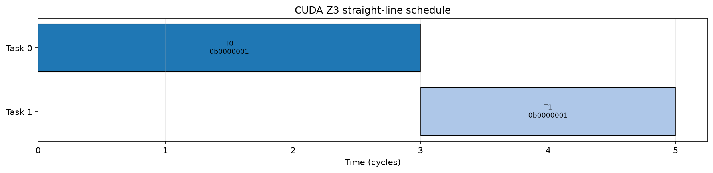
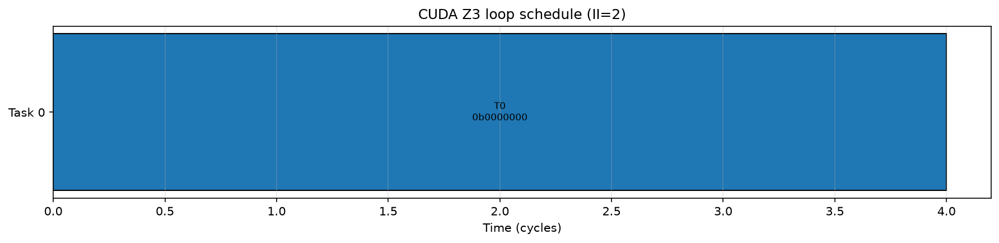

# CUDA Z3 调度器：把“能否重叠”写成可求解的约束

> 本节解释已经实现并由 CPU 测试验证的求解机制。文中的小型任务图用于展示语义，不是 GPU 性能实验。性能证据见后续 GEMM、FlashAttention 与 GDN 章节。

## 1. 这套求解器负责什么

CUDA kernel 中的一组任务并不是只要写法正确就一定能高效重叠。异步拷贝、矩阵计算、向量计算和同步操作共享不同资源，任务之间还存在数据依赖、跨迭代依赖以及共享存储寿命限制。朴素地交换两条语句，可能破坏正确性；把所有操作串起来，又会失去流水并行的机会。

本实现把这些问题写成 Z3 约束。求解器输出三类结果：

1. 直线任务列表中，每个任务的开始时间和最小 makespan；
2. 循环任务列表中，满足所有约束的最小 initiation interval（II）以及任务相位；
3. 自动多缓冲场景下，每个 buffer 所需的版本数。

实现位于 `tilelang/cuda/transform/z3_scheduler.py`，通过 `tilelang/cuda/transform/__init__.py` 注册两个 CUDA 专属 FFI 名称。没有显式调用这些接口时，CUDA 默认 pipeline 不会改变。

## 2. 直线任务：以完成时间为目标

对任务 $i$ 定义非负整数开始时间 $start_i$。一条延迟为 $L$ 的数据依赖 $(u,v,L)$ 写成：

$$start_v \geq start_u + L$$

共享资源的任务通过布尔变量选择先后顺序。这里约束的是发射间隔 $II_i$，不是把整段 latency 都当作资源占用：

$$O_{ij}\Rightarrow start_j\geq start_i+II_i$$

$$\neg O_{ij}\Rightarrow start_i\geq start_j+II_j$$

目标是最小化所有任务的最晚完成时间：

$$\min\ makespan,\qquad makespan\geq start_i+latency_i$$

核心实现保留了这一结构（`tilelang/cuda/transform/z3_scheduler.py:320-353`）：

```python
start_vars = [z3.Int(f"start_{index}", ctx) for index in range(num_tasks)]
for start in start_vars:
    solver.add(start >= 0)

for source, target, latency in data_deps:
    solver.add(start_vars[target] >= start_vars[source] + latency)

makespan = z3.Int("makespan", ctx)
solver.add(makespan >= 0)
for index, start in enumerate(start_vars):
    solver.add(makespan >= start + latencies[index])
solver.minimize(makespan)
```

### 一个真实求解例子

输入包含两个任务：T0 的 latency 为 3，T1 的 latency 为 2；T1 必须等 T0 完成。运行 `verbose=True` 后得到：

```text
[CUDA Python Z3] Scheduling 2 straight-line tasks
[CUDA Python Z3] Minimum makespan: 5
[CUDA Python Z3] Task 0: start=0, latency=3, II=2, resource=0b0000001
[CUDA Python Z3] Task 1: start=3, latency=2, II=1, resource=0b0000001
STRAIGHT_RESULT [0, 3] [0, 1]
```

完整输入输出保存在 [schedule-demos.txt](../../evidence/G1/schedule-demos.txt)，时间线由同一次求解直接生成：



## 3. 循环任务：用模调度压缩 II

循环体中的任务 $i$ 用逻辑迭代 $k_i$ 和周期内相位 $r_i$ 表示：

$$start_i=k_i\cdot II+r_i,\qquad k_i\geq0,\quad0\leq r_i<II$$

固定距离为 $d$ 的跨迭代依赖写成：

$$start_v-start_u\geq latency-II\cdot d$$

如果依赖距离需要由 buffer 版本数决定，负距离 $-b-1$ 引用自动 buffer $b$：

$$start_v-start_u\geq latency-II\cdot buf_b$$

资源互斥和 owner exclusion 同时约束正向与回绕交接。容量约束则直接限制所有自动版本占用的存储：

$$1\leq buf_b\leq num\_stages$$

$$\sum_{b\in group}buf_b\cdot buffer\_size_b\leq capacity_{group}$$

实现并不假定某个 II 可行，而是在 $[\max(task\_ii),\max(\sum latency,\sum ii)+1)$ 中做可行性二分。每次 Z3 只回答当前 II 是否可满足；找到可行解后继续向更小 II 搜索（`z3_scheduler.py:548-632`）。

### 从日志读出最小 II 和三个 buffer 版本

考虑一个自依赖任务。其约束为 $0\geq5-II\cdot buf_0$，buffer 最多有三个版本。II=1 时，即使 $buf_0=3$ 也无法满足；II=2 时，$buf_0=3$ 可行。因此最小 II 是 2。

实际二分日志完整展示了这一过程：

```text
[CUDA Python Z3 Loop] Testing II=3
[CUDA Python Z3 Loop] Testing II=2
[CUDA Python Z3 Loop] Testing II=1
[CUDA Python Z3 Loop] Result II=2, serial_fallback=False
BUFFER_RESULT [0] [3] 2
```

对应测试 `test_loop_negative_distance_recalculates_and_reads_buffer_versions` 还分别检查了两条路径：直接使用 solver model 中的版本数，以及根据调度重新计算版本数，二者都必须得到 `[3]`。



## 4. `unknown` 为什么不能当成“不合法”

Z3 可能返回三种结果：`sat`、`unsat`、`unknown`。只有 `unsat` 表示约束在当前 II 下不可满足。资源预算耗尽导致的 `unknown` 没有这个含义；把它当成 `unsat`，既可能错误剪枝，也可能让二分错误地增大 II。

CUDA 实现把这一步集中在一个检查函数中（`z3_scheduler.py:192-199`）：

```python
verdict = solver.check()
if verdict == z3.sat:
    return True
if verdict == z3.unsat:
    return False
raise Z3ScheduleUnknownError(
    f"Z3 returned unknown for {description}: {_unknown_reason(solver)}"
)
```

因此，`unknown` 会立即终止当前求解并给出原因。自动串行 fallback 只会在所有候选 II 都被明确证明 `UNSAT` 后出现；manual schedule 不可行则直接报错。测试通过注入 `unknown` 验证它不会进入 fallback，也不会被包装成 `Z3ScheduleInfeasibleError`。

## 5. 确定性、并发与调试产物

- 每次求解使用独立 `z3.Context`，避免全局 AST 状态影响后续求解。
- FFI 和直接 Python 入口共享 `RLock`，覆盖完整求解过程。
- 循环求解默认 `seed=42`、`rlimit=1,000,000`，结果按 `(start_time, task_index)` 稳定排序。
- `verbose=True` 写出 `schedule_info.json`、PNG 和 PDF。绘图或写文件失败只产生警告，不改变已经得到的调度。
- CUDA FFI 使用 `tl.cuda.transform.z3_schedule_python` 与 `tl.cuda.transform.z3_schedule_loop_python`，不会覆盖 Ascend 的同名机制。

## 6. 测试证据

主会话在独立环境中执行：

```bash
python -m pytest -q testing/python/transform/test_tilelang_cuda_z3_scheduler.py
```

结果为 **49 passed in 0.99s**。完整输出见 [solver-tests.txt](../../evidence/G1/solver-tests.txt)。

| 机制 | 对应真实测试 |
|---|---|
| makespan 与稳定 tie-break | `test_straight_line_minimizes_makespan_and_stable_tie` |
| 数据依赖与资源互斥 | `test_straight_line_data_latency_and_resource_exclusion` |
| owner exclusion 与 pipe order | `test_straight_line_owner_exclusion_and_pipe_order` |
| $start=k\cdot II+r$ | `test_loop_start_is_k_ii_plus_r` |
| 固定跨迭代距离 | `test_loop_fixed_cross_iteration_distance` |
| buffer 版本与容量 | `test_loop_negative_distance_recalculates_and_reads_buffer_versions`、`test_loop_memory_group_capacity` |
| 正向与回绕约束 | `test_loop_resource_forward_and_wraparound_exclusion`、`test_loop_owner_forward_and_wraparound_exclusion` |
| manual/offset/stage order | 同名 loop 测试组 |
| 确定性与并发 | `test_repeated_and_threaded_solves_are_deterministic` |
| `unknown` 与 fallback 分离 | `test_straight_line_unknown_is_not_reported_as_unsat`、loop unknown 测试 |
| JSON/PNG/PDF 与调试故障隔离 | `test_verbose_writes_json_in_tmp_path`、`test_verbose_writes_png_and_pdf_in_tmp_path`、`test_debug_failure_does_not_change_schedule` |

这一层证明了约束求解的语义。它还需要与 CUDA pipeline、真实任务分析和设备成本模型连接，才能讨论 kernel 级收益；后续章节分别给出这些连接代码和实测结果。
