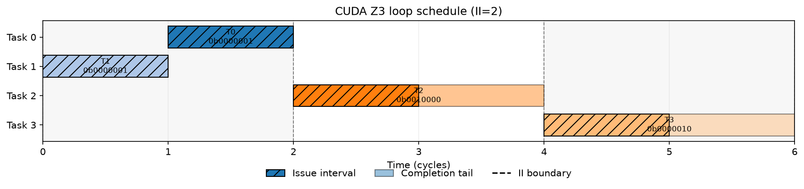

# CUDA Z3 pipeline adapter：把求解结果变成真正的流水 IR

> 本节对应 `src/transform/z3_pipeline_planning.cc`、`src/transform/z3_task_analysis.cc`、`tilelang/language/annotations.py` 和 `src/transform/inject_pipeline.cc` 的 buffer-version override。它连接“会求解”与“能编译”，但不把 owner-ring、通用 Let clone 或任意 CUDA IR 的自动提取说成已经支持。

## 1. 接口与默认行为

用户通过 `z3_pipeline_annotations(...)` 为 `T.Pipelined` 提供任务 latency、逐任务 II、resource flags、依赖、buffer 信息以及 manual/offset 选项。新 pass 由以下配置显式启用：

```python
pass_configs = {
    tilelang.PassConfigKey.TL_ENABLE_Z3_PIPELINE_PLANNING: True,
    # 仅需要从 IR 补全缺失 problem 字段时开启；显式空数组仍是用户 override。
    tilelang.PassConfigKey.TL_ENABLE_Z3_TASK_ANALYSIS: True,
}
```

两个配置默认值都是 `False`。主 CUDA pipeline 在 Unroll/Simplify 后先运行可选的 `InferZ3PipelineProblem`，再运行 `Z3PipelinePlanning` 和原始 pipeline passes；两个 C++ pass 也分别检查自己的配置。只开 planning 可继续使用完整手写 problem。主链只开 analysis 会明确报错，避免补全后静默落到 stock scheduler；离线检查则允许单独运行 Infer。普通 `import tilelang.cuda` 注册 task-cost FFI，但不探测设备。没有 `tl_z3_pipeline` 标记时，即使配置开启也不做改写。automatic warp specialization 与 Z3 标注模块互斥，避免两个调度器先后重写同一 loop。

真实设备测试先用同一份带标注的 PrimFunc 编译 default-off：`calls == []`，即 solver 调用为 0。随后 opt-in 编译，计数变为 1，证明确实发生了求解，而不是只存在一套未使用的 Python 文件。

主链接入后的联合 host 回归为 **148 passed**，覆盖 estimator→真实 solver 的调用顺序、距离 2 的递增/递减跨迭代依赖、stage-order 投影与违规结果拒绝、跨 stage Bind 拒绝，以及普通包导入自动注册 FFI。构建与测试原始输出见 [main-pipeline-build-final.txt](../../evidence/G3/main-pipeline-build-final.txt) 和 [main-pipeline-host-tests-final.txt](../../evidence/G3/main-pipeline-host-tests-final.txt)。

## 2. 从 start/II 到 stage/order

对求解返回的每个 start，adapter 计算：

```text
k[i]       = floor(starts[i] / II)
stage[i]   = k[i] - min(k)
residue[i] = starts[i] - k[i] * II
```

物理发射顺序按 `(residue, -stage, source_index)` 排序。下游 `tl_pipeline_order` 需要的是“原 statement 位于哪个发射位置”，所以还要对 physical order 求逆：

```cpp
for (size_t position = 0; position < n; ++position) {
  inverse_order[physical_order[position]] = static_cast<int>(position);
}
```

跨 stage 的同相位 tie 由较大 stage 先发射。测试中的 `[0,50,151,152], II=152` 产生 physical order `[3,0,1,2]` 和 annotation order `[1,2,3,0]`，不是把 sorted indices 直接写入 `tl_pipeline_order`。

## 3. Pipeline depth 不能照抄输入 num_stages

求解器的 `num_stages` 首先是自动 buffer 的版本上界，而 Z3 的 stage 可能更深。如果直接沿用输入深度，下游 wait/barrier 深度就可能不足。因此 adapter 输出以下深度：

```text
cuda_depth = max(input_num_stages,
                 max(stage) + 1,
                 max(buffer_versions))
```

新增的 `test_output_depth_covers_solver_stages_and_buffer_versions` 同时注入一个需要 5 层的 stage 和 3 个 buffer 版本，验证最终 `num_stages == 5`。真实设备例子的 solver start 为 `[1,0,2,4]`、II=2，对应 stage `[0,0,1,2]`，最终深度为 3。

## 4. 逐 buffer versions 不再由下游重新猜测

Z3 返回的 buffer versions 通过 `Map<Var, IntImm>` 传给 `tl_pipeline_buffer_versions`。key 是 `Buffer.data`，value 是正版本数。`InjectSoftwarePipeline` 在自动 liveness 和 double-buffer 启发式之前优先读取显式 override，未标注的 buffer 保持原推导。

下游会拒绝 0/负数、未知 buffer、非当前 pipeline buffer、重复或歧义映射以及整数溢出。steady loop 和单阶段回退路径都会清理内部 annotation，避免二次 override。这样，求解器选定的存储解不会在下游被另一套启发式悄悄替换。

## 5. 真实设备证据

集成测试位于 `testing/python/language/test_tilelang_cuda_z3_pipeline.py`，包含四个循环任务：两份 global→shared copy、一份 vector add、一份 output store。真实求解输出为：

```text
starts = [1, 0, 2, 4]
II = 2
fallback = False
```

`evidence/G3/device-schedule/schedule_info.json` 保存同一次求解结果，下面的时间线由它直接生成：



测试依次断言：

1. default-off 的 solver 调用数为 0；
2. opt-in 恰好调用一次真实 Z3；
3. `fallback=False` 且 II=2；
4. `A+B` 的每个输出元素与 PyTorch 完全一致；
5. debug JSON 中的 starts 与 Python 计数包装器收到的结果一致。

日志见 [device-integration-test-retry.txt](../../evidence/G3/device-integration-test-retry.txt)。新增 adapter、buffer override 与原始 pipeline 的 host 回归合计 **130 passed**，见 [pipeline-host-tests-retry3.txt](../../evidence/G3/pipeline-host-tests-retry3.txt)。

## 6. 一次有信息量的失败：多个 async stages

第一次设备集成没有直接成功。Z3 给出的两个 copy producer 落在不同 stage，而 stock `InjectSoftwarePipeline` 报错：

```text
A dependency on multiple async stages is not supported
```

这不是 Z3 求解失败，也不是数值错误，而是 stock CUDA IR 的表达边界。完整日志保留在 [device-integration-test.txt](../../evidence/G3/device-integration-test.txt)。随后使用两个 producer 同 stage 的可表达调度，才完成上述 off/on 验证。

当前仍有三条明确边界：

- `InferZ3PipelineProblem` 已能提取受限 CUDA IR 子集的 task cost、RAW/WAR/WAW、跨迭代依赖、resource mask 和 shared buffer 字段；任意动态/不透明 IR 仍需显式 annotation 或明确报错，不能宣称任意 kernel 全自动；
- owner exclusion 仍在求解前拒绝。无 Let 克隆需求的 stage-order 会转发并核验；需要跨 stage Let 克隆的调度仍由下游拒绝；
- 多 async producer-stage 需要额外约束或扩展下游，不能仅凭 solver 可行就宣称 CUDA 可执行。自动分析当前采用更保守的 producer/consumer 同阶段约束路径。

这些限制进入 feature parity 清单，不会被静默降级为“全功能完成”。后续章节的算子实验只使用可验证、可执行的配置，并分别报告搜索质量与编译限制。
