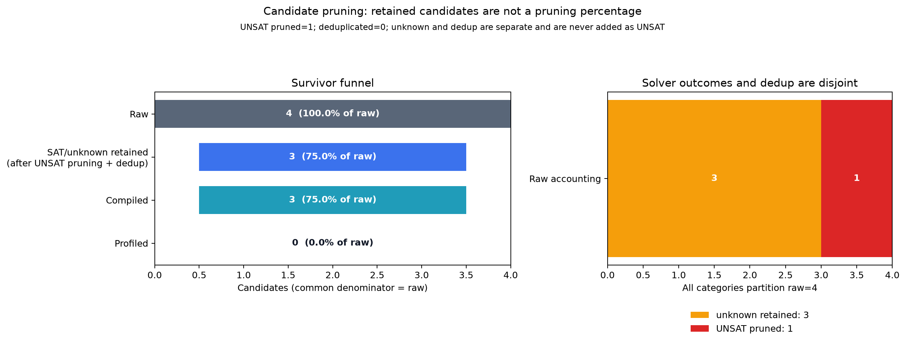
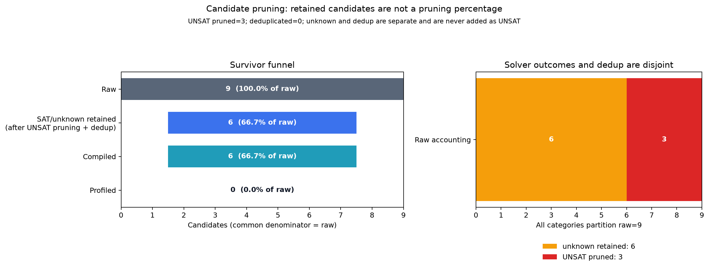

# GDN 资源剪枝：用可验证的容量公式减少无效编译

> 本节是 GDN 核心搜索的第一项实证。它证明一部分候选可以在编译前被合法排除，但不证明最终性能收益。性能搜索的计数和延迟见后续实验章节。

## 1. 为什么不能把结构 SAT 当作能运行

`block_DV`、stage 和 group tile 在语法上都容易构造，但 SM120 的 shared-memory opt-in 上限是 101376 B。GDN 的 fused forward 和 prepare_h 都包含多版本共享缓冲，tile/stage 的变化会真实改变动态 shared-memory 需求。

本实现把检查分成三类：

- `UNSAT`：有生成代码和容量证据证明不能运行；
- `UNKNOWN`：容量未超限，但寄存器、launch 和其他资源尚未完全证明；
- `SAT`：只用于当前检查项确实已知可满足的场合，不用它掩盖其他未知资源。

`Indeterminate` 让 UNKNOWN 候选继续进入编译验证，不增加 Z3 solver check，也不计入 UNSAT。

## 2. Forward：`38912 + 576 × block_DV`

从 `fused_fwd.py` 的 shared buffer 形状推得候选公式，再逐个读取生成代码中的动态 shared-memory 参数：

| `block_DV` | 公式字节数 | 生成代码实测 | 101376 B 上限判定 | 完整正确性 |
|---:|---:|---:|---|---|
| 16 | 48128 | 48128 | 保留，其他资源 UNKNOWN | 通过 |
| 32 | 57344 | 57344 | 保留，其他资源 UNKNOWN | 通过 |
| 64 | 75776 | 75776 | 保留，其他资源 UNKNOWN | 通过 |
| 128 | 112640 | 112640 | **UNSAT** | launch 失败 |

128 的真实错误是：

```text
tvm.error.InternalError: Failed to set the allowed dynamic shared memory size to 112640
```

证据见 [gdn-fwd-shared-memory.json](../../evidence/G5/gdn-fwd-shared-memory.json) 和 [forward 128 日志](../../evidence/G5/gdn-fwd-correctness.txt)。16/32/64 的 dense、h0/no-dht、padded 校验均通过，16/32/64 的日志分别位于同目录。

因此 forward 的 raw 空间从 4 个变成 3 个保留候选。真实 Z3 审计为：

```text
raw=4, kept=3, checked=1, unsat=1, unknown=3
```



## 3. Backward prepare_h：`57344 + 18432 × stages`

`prepare_h_num_stages` 改变多版本 K/V/A buffer 的数量。生成代码给出的三档结果为：

| prepare_h stages | 公式字节数 | 生成代码实测 | 判定 |
|---:|---:|---:|---|
| 1 | 75776 | 75776 | 保留，其他资源 UNKNOWN |
| 2 | 94208 | 94208 | 保留，其他资源 UNKNOWN |
| 3 | 112640 | 112640 | **UNSAT** |

stage 3 的三个 group 配置都在 launch 时超过容量。stage 1 的一次 `dv` 偶发不一致没有被隐藏：随后进行了同输入复测和 **1000 次公开 backward 重复校验**，全部通过，见 [determinism 日志](../../evidence/G5/gdn-bwd-stage1-group8-determinism.txt)。容量证据见 [gdn-prepare-h-shared-memory.json](../../evidence/G5/gdn-prepare-h-shared-memory.json)。

因此 backward 的 raw 空间从 9 个变成 6 个保留候选：

```text
raw=9, kept=6, checked=3, unsat=3, unknown=6
```



## 4. 代码如何把证据接到 Z3

`GDNResourceChecker` 只在公式超限时返回 UNSAT；其他情况保留 UNKNOWN：

```python
if direction is Direction.BWD:
    dynamic_bytes = prepare_h_dynamic_shared_bytes(stages)
else:
    dynamic_bytes = forward_dynamic_shared_bytes(block_DV)
```

`make_config_space` 将结果映射给通用 pruner：UNSAT 用 `False`，可确定的 SAT 用 `True`，UNKNOWN 用 `Indeterminate`。这不是把编译失败倒填成 Z3 结果：公式先由源码分配推导，再用所有配置的生成代码验证，最后才进入搜索。

## 5. 这组结果支持什么、还不支持什么

它支持以下判断：默认 `block_DV=128` 和 prepare_h stage 3 的候选可以在编译前被可靠排除，减少无效设备编译与 launch 尝试。真正的加速比仍要计入 Z3 求解、成本评分、其他候选编译、校验和 profile 时间，不能只按候选数比例宣称。

它还说明默认配置并不总是可用。backward 的 forward artifacts 改用固定 `block_DV=64` 才能越过 forward 的容量限制，该值不是额外搜索旋钮。另一个独立正确性问题是 `dh0`：上游只在 `use_dht=True` 时写回梯度，导致 h0 无 dht 时返回全零，已单独修复并验证，不能归因于 Z3。

后续 GDN 对照会分别报告 `stock-raw`、合法全集穷举和 cost-model top-k 的实际编译/profile 次数、搜索 wall time 与最终延迟，验证这些容量优势是否能转化为端到端收益。
