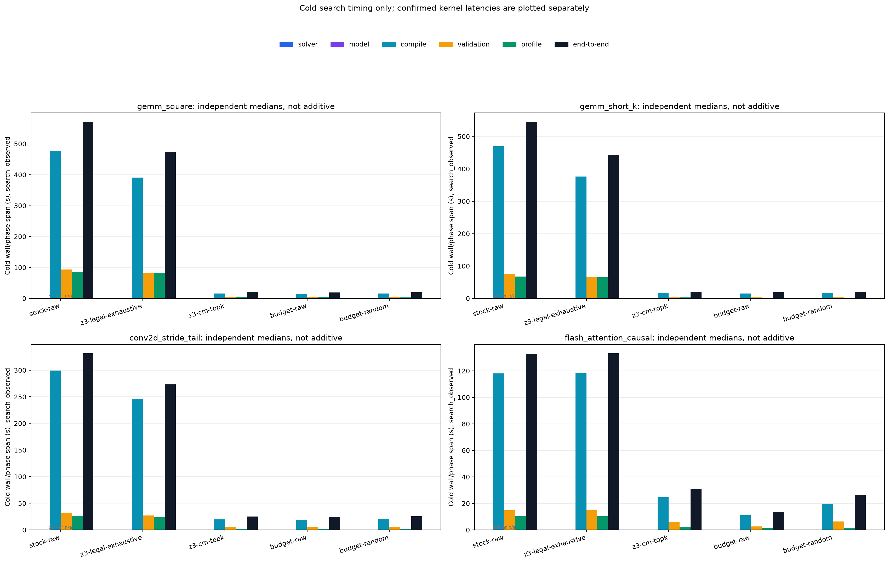
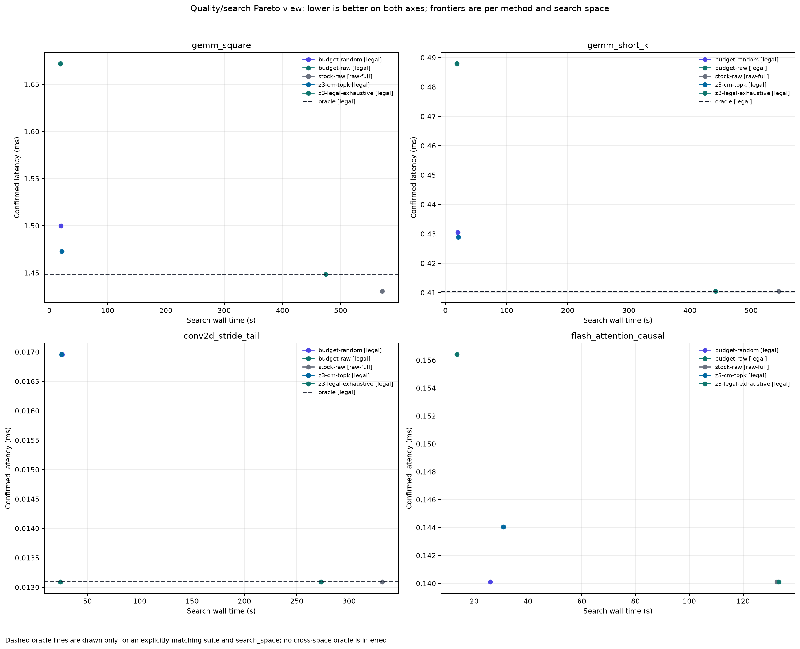

# 经典算子：固定搜索空间与公平对照

## 1. Workload 与搜索空间

三个经典 TileLang 算子家族共有四个正式 workload。输入、kernel 输出为 FP16，累加与独立数学参考为 FP32。raw/legal 数字来自同一份 `ConfigSpace` 和本机显式 shared-memory 必要下界；legal 不表示所有配置都能通过后续 lowering、device compile 或 launch。

| suite | 固定问题 | raw | legal | 主预算 |
|---|---|---:|---:|---:|
| gemm_square | FP16 GEMM，M=N=K=4096，B[n,k] 转置 | 288 | 240 | top-10 |
| gemm_short_k | M=N=8192，K=256 | 288 | 240 | top-10 |
| conv2d_stride_tail | NHWC implicit GEMM，33×33→17×17，C64→F96，stride 2、tail | 144 | 120 | top-10 |
| flash_attention_causal | BSHD，B1/H16/S2048/D64，causal | 54 | 54 | top-10 |

GEMM 的空间为 `block_M/N=[64,128,256]`、`block_K=[32,64]`、`num_stages=[0,1,2,3]`、`threads=[128,256]`、rasterization 两值。Conv 删除 kernel 不消费的 rasterization 轴。FA 使用 `block_M/N=[64,128,256]`、stages 1–3 和两种线程数。

方形 GEMM 另做预注册的 top-1/5/20 敏感性。额外预算只运行 guided、`budget-raw` 和 `budget-random`，复用同 suite/repetition/cache/seed 的完整 top-10 stock/legal 基线。复用条件、分母和失败回退见 [sensitivity baseline plan](../../manifest/classic-sensitivity-baseline-plan.json)。主 top-10 的完整 oracle 成本单独保留，不能将基线复用描述为零成本。

## 2. 候选确实经过冻结 kernel factory

每个候选都调用对应模块的 `kernel_factory(config, shape=...)` 得到真实 JITKernel，再由 stock `AutoTuner` 编译、校验和 profile。没有为 cost model 另写替代 PrimFunc，也没有用简单的 fake callable 充当正式性能对象。

```python
return factory(
    config,
    shape=_fixture.shape,
    target=_target,
    pass_configs=_pass_configs,
    compile=_compile,
)
```

生产默认使用 `GuidedAutoTuner`、`SearchExperiment` 和 JITKernel 的真实 `Profiler`。mock 仅用于 CPU 单元测试，不能进入结果表。stock-raw、legal-exhaustive、cost-model top-k、原始顺序等预算、固定 seed 随机等预算五种策略使用同一输入和 correctness 路径。

## 3. 独立 FP32 reference 与 correctness

固定 seed 为 `20261026`。CPU 正态输入转为 FP16 后移动到 CUDA；同一 tuner 的候选共享 tensor 对象，避免数据生成顺序影响比较。

- GEMM 直接计算 FP32 `A @ B.T`；Conv 按 NHWC cross-correlation 定义逐维计算；FA 显式构造 causal mask、FP32 softmax 和 PV 累加。
- matmul/conv 在 reference 期间关闭 TF32 并恢复现场。FA 不调用融合的 SDPA 充当参考。
- actual 与 reference 在 FP32 中比较，默认 `atol=rtol=0.02`，`max_mismatched_ratio=0`。任何一个超差、NaN 或 Inf 都失败，不用允许的 mismatch 比例掩盖局部错误。
- reference timing 与 candidate timing 分开记录，validation/reference 不塞进 candidate latency。`collected`、compile-only 和数值通过分别入账。

CPU 测试与小形状数值测试定义见 [operators README](../../benchmark/z3_cost_model/operators/README.md)。正式大形状仍必须逐个通过真实 kernel 校验，不能用这些前置测试代替。

## 4. 约束只删除可证明的 UNSAT

GEMM/Conv 的 shared 必要下界为 `max(2*block_K*(block_M+block_N)*max(1,num_stages), 2*block_M*block_N)`，FA 为 `max(Q+K,Q+V,O)`。这些公式利用操作数在各有效 pipeline 版本中的同时存活关系，以及输出在循环后的复用机会，不声称等于最终 post-lowering shared 分配。首轮 stock-raw 的 48 个动态 shared 超限与版本化公式逐一对应，零漏报、零误报；据此将 GEMM legal 从 256 收紧到 240，guided top-10 配置逐项不变。首批保留为约束 validation，后续正式批次使用修订空间。stage 版本、reuse、padding、barrier、寄存器、TMA 对齐和 target-specific 指令选择在信息不足时保持 UNKNOWN 或不予编码。

SM120 没有照搬 sm_80/sm_90 的 atom 条件，因此 unknown=0 不能被解释为“所有合法性已证明”。`CostModelCapacityError` 也不同于 Z3 UNSAT：容量未知的候选保留在宇宙中并排在有效预测之后，top-k 覆盖时仍可进入编译验证。模型容量 UNKNOWN 与候选 compile/validation/profile failure 分开计数。

## 5. 缓存与统计分母

每次 arm/repetition 使用独立 Python 进程和 run-owned TileLang/CUDA/Torch/XDG/TMP 缓存，搜索 warmup=10、repeat=50，`early_stop=False`，grouped compile 与 multi-GPU 关闭。每轮保存 before/after 清单、config、环境、events 和 summary。

结果聚合要求每个选中配置恰好有一个终态 trial。缺失或重复 trial、cache-only、只收集到节点、错误结束的 run 不进入性能比较。质量比较优先使用完整 legal-oracle；若它不完整，则回退到完整 raw 的实测最优并标记 `quality_reference=stock-raw`。预测相关优先使用完整 legal-oracle，否则只连接 raw 中实际成功的配置，同时标记 `legal_oracle_complete=false` 和实际分母，不把失败候选藏起来。

正式主实验的独立协议审计为 `expected_runs=60`、`observed_runs=60`、`distinct_pids=60`、`ignored_sensitivity_runs=27`、`errors=[]`。审计逐项检查 identity、PID、warmup/repeat、候选预算、缓存起点与路径、profile 和 latency，完整记录见 [classic-protocol-audit.json](../../evidence/G6/classic-v2/classic-protocol-audit.json)。

最终表格同时报告 raw/legal/选中数、compile/profile 次数、各阶段墙钟、搜索内 best、独立确认值、失败候选和预测分母。搜索计数减少与最终配置质量需要分别成立，不能仅凭“少跑了几个候选”宣称模型有效。

## 6. 两个 GEMM 的主预算结果

下表来自三次 cold repetition。compile/profile 是实际候选构造和成功实测次数；stock 的 48 个容量失败仍保留在 compile/validation 分母。wall、search best、speedup 和 quality 分别按各自定义对三次结果取中位数，不能用表内两个 wall 中位数反推 speedup。quality 以同轮完整 legal-oracle 的实测最优为分母，大于 1 表示搜索期 best 更慢；stock 本身不是该 oracle 的质量基线，因此对应单元格不写 1。

| suite | 策略 | compile / profile | wall (s) | speedup | search best (ms) | quality |
|---|---|---:|---:|---:|---:|---:|
| gemm_square | stock-raw | 288 / 240 | 571.282 | 1.000× | 1.418417 | — |
| gemm_square | z3-legal-exhaustive | 240 / 240 | 474.276 | 1.210× | 1.423988 | 1.00000 |
| gemm_square | z3-cm-topk | 10 / 10 | 21.251 | 26.404× | 1.451868 | 1.01910 |
| gemm_square | budget-raw | 10 / 10 | 19.060 | 30.052× | 1.669374 | 1.17326 |
| gemm_square | budget-random | 10 / 10 | 19.902 | 28.705× | 1.457813 | 1.02207 |
| gemm_short_k | stock-raw | 288 / 240 | 545.344 | 1.000× | 0.397395 | — |
| gemm_short_k | z3-legal-exhaustive | 240 / 240 | 441.797 | 1.213× | 0.396822 | 1.00000 |
| gemm_short_k | z3-cm-topk | 10 / 10 | 20.901 | 26.092× | 0.425074 | 1.07296 |
| gemm_short_k | budget-raw | 10 / 10 | 18.971 | 28.747× | 0.439400 | 1.10355 |
| gemm_short_k | budget-random | 10 / 10 | 20.196 | 27.042× | 0.415585 | 1.04017 |

两个形状都显著减少了搜索工作，但排序质量不同。方形 GEMM 的 guided quality 为 1.01910，优于同预算 raw-order 的 1.17326；短 K 的 guided quality 为 1.07296，差于同预算 random 的 1.04017。三轮 Spearman 中位数分别约为 0.3806 和 0.0999，Kendall tau-b 中位数分别为 0.3213 和 0.1018。

更直接的头部审计显示，方形 GEMM 的 oracle 最优预测名次为 32、33、32，三轮 top-10 recall 都为 0；它能取得约 1.9% 的搜索期质量差，是因为保留了其他接近最优的候选，不是因为选中了实测第一名。短 K 的 oracle 最优三轮都排 120/240，top-10 recall 为 0、0、0.1，质量损失更明显。短 K 不能因为搜索加速接近 26× 就被描述为保住了同等配置质量。

逐 run 数字、空间 ID 配对和相关性分母见 [主分析](../../evidence/G6/classic-v2/main-analysis/analysis.json)、[summary.csv](../../evidence/G6/classic-v2/main-analysis/summary.csv) 与 [correlations.csv](../../evidence/G6/classic-v2/main-analysis/correlations.csv)。搜索期 best 还不等于最终确认 latency，四类 suite 的独立 winner 复测在后文单列。

## 7. 方形 GEMM 的预算敏感性

下表使用三次 cold run 的中位数。`wall` 是各自 end-to-end 的中位数，`speedup` 是每次 `stock_wall / arm_wall` 的中位数，两种聚合不能直接互换。`search best` 为搜索内最小值，`quality` 为 guided/search-best 相对同空间 legal-oracle 最优的比值；`raw-order quality` 是等预算原始顺序的对应比值。top-1/5/20 均复用 top-10 完整基线，字段 `baseline_shared_with_top10=true` 与 `oracle_shared_with_top10=true` 可直接检查。

| top-k | guided wall (s) | speedup | guided search best (ms) | guided quality | raw-order quality |
|---:|---:|---:|---:|---:|---:|
| 1 | 2.950 | 198.912× | 1.466698 | 1.02248 | 1.18185 |
| 5 | 11.990 | 48.200× | 1.448417 | 1.01797 | 1.16890 |
| 10 | 21.251 | 26.404× | 1.451868 | 1.01910 | 1.17326 |
| 20 | 43.863 | 13.163× | 1.453109 | 1.02127 | 1.10980 |

top-5 的质量最好，top-10 没有继续改善，top-20 也没有带来更多收益。原始顺序控制虽然使用相同预算，质量明显更差，说明解析模型在候选选择上有独立作用，不只是少测了配置。另一方面，raw 最优配置仍可能不在 top-20 中，rasterization 的 L2 locality 又明确未建模，因此不能把 top-k 扩大等同于覆盖全局最优。

逐 run 结果和配对分母见 [sensitivity analysis](../../evidence/G6/classic-v2/sensitivity-analysis/analysis.json) 与 [runs.csv](../../evidence/G6/classic-v2/sensitivity-analysis/runs.csv)。基线复用不是免费 oracle：top-10 的 stock/legal 穷举成本已先计入主实验，额外预算只运行 guided 与两个控制。

## 8. Conv2D：整体排名相关较高，但 top-10 漏掉最优

三轮 Conv 的 120 个 SAT 候选在 legal-exhaustive 中全部编译、校验和 profile 成功；stock 另有 24 个动态 shared-memory 失败。仅做 Z3 pruning 就将 wall 中位数从 331.768 s 降到 273.114 s。guided top-10 进一步降到 25.093 s，但质量明显损失，必须与搜索加速同时阅读。

| 策略 | compile / profile | wall (s) | speedup | search best (ms) | quality |
|---|---:|---:|---:|---:|---:|
| stock-raw | 144 / 120 | 331.768 | 1.000× | 0.013454 | — |
| z3-legal-exhaustive | 120 / 120 | 273.114 | 1.217× | 0.013654 | 1.00000 |
| z3-cm-topk | 10 / 10 | 25.093 | 13.218× | 0.016161 | 1.19384 |
| budget-raw | 10 / 10 | 24.125 | 13.806× | 0.013462 | 0.99196 |
| budget-random | 10 / 10 | 25.683 | 12.918× | 0.016280 | 1.20226 |

stock 与 legal-oracle 三轮都选 `block_K=32, block_M=64, block_N=64, num_stages=0, threads=256`。这个配置在解析模型中的名次三轮都为 **16/120**，因此 top-10 不可能选中它。guided 三轮的搜索期 best 都是 `block_K=64, block_M=64, block_N=64, num_stages=1, threads=256`。raw-order 选中了前者的原始顺序位置，fixed-seed random 则与 guided 一样落到后者；Conv 的结果不支持“模型排序优于等预算对照”。

三轮 Spearman 中位数为 0.80170，Kendall tau-b 中位数为 0.62314，但 top-1/top-2/top-3 recall 都为 0，top-10 recall 都为 0.6。整体序列相关与头部候选覆盖是两件事，较高的全局相关系数不能保证最优项进入预算。budget-raw 的 quality 小于 1 来自同配置在不同 run 的计时波动，不表示它超越了同空间最优的理论上界；独立确认会对相同配置按身份处理。

## 9. 排名审计字段与证据

`correlations.csv` 现在同时保存 Pearson、Spearman、Kendall tau-b、top-1/2/3/budget-k recall、oracle 最优的 config ID、预测名次、是否进入实际 top-k，以及配对分母。预测名次按有限 score 和 canonical config ID 稳定排序；recall 只连接具有限预测且成功实测的配置。完整 legal-oracle 不可用时，明确标记 `legal_oracle_complete=false`，不会把 raw 中的失败候选从分母说明里隐去。

这些派生量全部由 [analyze_results.py](../../benchmark/z3_cost_model/operators/analyze_results.py) 从 events 重算，不依赖手工摘抄。扩展后的经典算子与共享可视化回归为 **78 passed**，日志见 [operator-rank-analysis-regression.txt](../../evidence/G6/classic-v2/operator-rank-analysis-regression.txt)。

## 10. FlashAttention：没有 Z3 数量剪枝，top-k 仍减少实测

FA 的 raw 与 SAT 空间都为 54，因此 legal-exhaustive 没有候选数量优势，wall 中位数还与 stock 基本相当。两者都有 24 个失败候选，成功 profile 为 30；这说明当前编码的 FA shared-memory 必要条件只是保守下界，并未覆盖所有后续 launch 限制。相应 legal-oracle 不完整，质量分母使用完整 stock-raw 的实测最优，排名只连接 raw 中成功的 30 项并明确标记 `legal_oracle_complete=false`。

| 策略 | compile / profile | wall (s) | speedup | search best (ms) | quality |
|---|---:|---:|---:|---:|---:|
| stock-raw | 54 / 30 | 132.564 | 1.000× | 0.140430 | — |
| z3-legal-exhaustive | 54 / 30 | 133.291 | 0.990× | 0.140566 | 0.99925 |
| z3-cm-topk | 10 / 10 | 30.903 | 4.321× | 0.142254 | 1.01158 |
| budget-raw | 10 / 5 | 13.658 | 9.671× | 0.153160 | 1.09065 |
| budget-random | 10 / 5 | 26.000 | 5.136× | 0.140904 | 1.00338 |

guided 的 10 个候选全部实测成功，两个控制各有 5 个成功和 5 个失败。这里的 compile/profile 缩减不能与“所有 raw 都合法”混为一谈，失败候选仍在各 arm 的尝试与日志中。

FA 的 Spearman 中位数为 **-0.39058**，Kendall tau-b 为 **-0.27806**；stock 最优配置三轮都排预测第 27，top-10 recall 都为 0.2。搜索期 guided best 比 stock best 慢约 1.16%，并不证明排序准确。它的价值只限于本次 top-10 找到了一个接近的 stage-2 配置，最终差距由独立确认给出。

## 11. 四类 workload 的独立 winner 确认

四个 suite 都用 candidate-median 从三次 cold trial 冻结各策略配置，再执行 7 轮 ABBA、50 warmup、每轮 200 个 L2-flushed CUDA-event 样本。下表的 confirmed latency 是每个 arm 独立测量的中位数；pair ratio 则来自该配置对的 pair-local round medians。guided 在不同配置对中会重新测量，因此 ratio 不一定等于表内两个 standalone 中位数相除。

| suite | guided confirmed (ms) | exhaustive confirmed (ms) | guided / exhaustive | guided / budget-raw | guided / budget-random |
|---|---:|---:|---:|---:|---:|
| gemm_square | 1.472920 | 1.448576 | 1.017253 | 0.874553 | 0.991945 |
| gemm_short_k | 0.428928 | 0.410432 | 1.039685 | 0.880870 | 1.000000 |
| conv2d_stride_tail | 0.016960 | 0.013088 | 1.295844 | 1.295844 | 1.000000（同配置） |
| flash_attention_causal | 0.144040 | 0.140096 | 1.021014 | 0.921849 | 1.021014（同一对照配置） |

方形 GEMM guided 相对完整合法穷举 winner 慢 1.73%，但比 budget-raw 快 12.54%，也略优于 budget-random。短 K guided 比穷举慢 3.97%，比 budget-raw 快 11.91%，与 budget-random 的 pair median 比为 1；其逐轮差有正有负，不能写成稳定优于随机。

Conv 的独立差距比搜索期更大：guided 相对 stock/legal/budget-raw 的共同 winner 慢 **29.58%**，与 budget-random 则是同一配置。FA guided 相对 stock/legal/budget-random 的共同 stage-1 配置慢 **2.10%**，刚好超过 2% 诊断线；七轮 paired difference 范围为 -0.002112 到 0.006000 ms，存在一轮反向，不能把点估计写成统计上确定的回归。guided 相对 budget-raw 的 ratio 为 0.921849。

这些 classic 比值是描述性结果，不套用 GDN 的专用验收门禁。联合 JSON 的 `acceptance_passed=true` 只对应 `execution_and_correctness_only`；具体 pair 的 `within_2_percent` 或 `not_slower_than_equal_budget_control` 仍可为 false，不能与执行通过混读。完整数据见 [confirmed-summary.csv](../../evidence/G6/classic-v2/confirmed-analysis/confirmed-summary.csv) 和 [confirmation-comparisons.csv](../../evidence/G6/classic-v2/confirmed-analysis/confirmation-comparisons.csv)。





## 12. 正确性与误差诊断

20 个 suite/arm 的确认记录都通过计时前后 correctness，所有元素均为有限值，且 `mismatched_ratio=0`。判定使用 FP32 中的 `isclose(atol=0.02, rtol=0.02)`，不允许任何超差元素；这与仅报告一个平均误差不同。

| suite | correctness | max abs error | max relative diagnostic | mismatch |
|---|---|---:|---:|---:|
| gemm_square | 通过 | 0.00197554 | 33.6663 | 0 |
| gemm_short_k | 通过 | 0.000488758 | 4.11991 | 0 |
| conv2d_stride_tail | 通过 | 0.000488639 | 0.733332 | 0 |
| flash_attention_causal | 通过 | 0.000931025 | 1193.186 | 0 |

relative diagnostic 定义为 $|actual-reference|/(|reference|+10^{-12})$，参考值接近零时可以很大；它不是 `isclose` 的通过率，也不是 mismatch ratio。方形 GEMM 的大相对诊断已定位于近零 reference 元素。正文同时列出绝对误差、相对诊断和严格 mismatch，避免只挑其中一种指标。所有 winner 的真实配置、逐轮样本、缓存清单和源码 SHA 位于 [classic-confirmation-v1](../../evidence/G6/classic-confirmation-v1/)。
