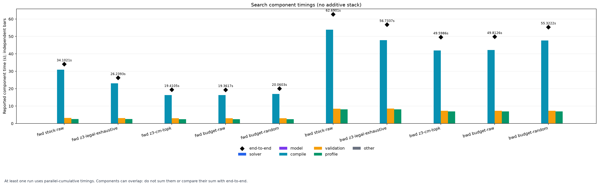
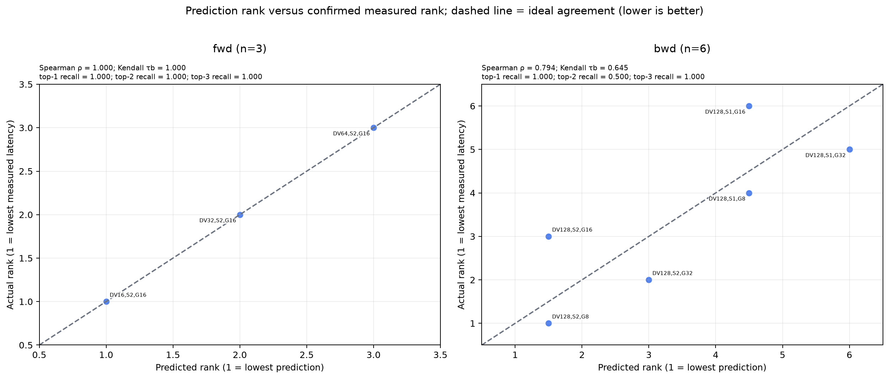
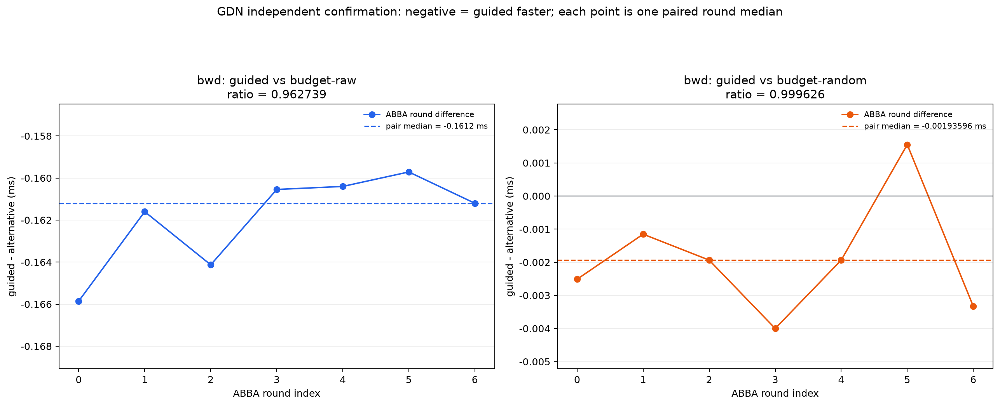

# GDN 验收：搜索量减少与最终配置质量

## 1. 结论及其适用范围

在 T8192、B=1、Hg=4、H=8、K=DV=128 的 held-out 上，Z3 约束与解析成本模型完成了两类结果：

- **搜索工作减少**：fwd 的候选构造从 4 减到 2，搜索墙钟中位数从 34.102 s 降到 19.410 s，为 **1.757×**；bwd 从 9 减到 3，墙钟从 62.690 s 降到 49.599 s，为 **1.258×**。对应的 wall-time 节省约为 **43.1%** 和 **20.5%**。
- **最终配置达到验收线**：fwd 的所有策略最终都选 `block_DV=16`，bwd 的 guided 与同空间 exhaustive 同选 `stage=2, group=8`。7 轮 ABBA 确认通过 fwd/bwd 的 correctness 和质量门禁。

bwd guided 对等预算随机对照的比值为 **0.999626**，差距极小。这里可支持的结论是“更少搜索得到不劣于对照的配置”，不能据此宣称稳定的显著 kernel 提速。owner-ring、通用 Let clone 等编译器缺口与此外层搜索收益无关，仍按附录状态保留。

## 2. 正式 cold 搜索数据

下表的搜索 wall 是三次各自 `end_to_end_wall_seconds` 的中位数。设第 $i$ 次 stock 与某策略的墙钟为 $T_{stock,i}$ 和 $T_{arm,i}$，表中“相对 stock”是三次 $S_i=T_{stock,i}/T_{arm,i}$ 的中位数。两种中位数分别计算，不能将展示的两个中位数直接相除。文中的 wall-time 节省为 $1-1/S$；因此它与同一列 speedup 一致，而与 wall 中位数之比可能不同。`search best` 是搜索过程中观察到的最小值，`confirmed` 来自后续独立测量；两者不混用。compile/profile 是候选构造与实际 profile 次数，raw 路径的失败候选仍计入尝试。

### 2.1 Forward

| 策略 | compile / profile | 搜索 wall (s) | 相对 stock | search best (ms) | confirmed (ms) |
|---|---:|---:|---:|---:|---:|
| stock-raw | 4 / 3 | 34.102 | 1.000× | 0.303556 | 0.308992 |
| z3-legal-exhaustive | 3 / 3 | 26.239 | 1.311× | 0.303363 | 0.308992 |
| z3-cm-topk | 2 / 2 | 19.410 | 1.757× | 0.302591 | 0.308992 |
| budget-raw | 2 / 2 | 19.362 | 1.765× | 0.302373 | 0.308992 |
| budget-random | 2 / 2 | 20.060 | 1.704× | 0.303533 | 0.308992 |

fwd 的 raw 空间中 `block_DV=128` 因动态 shared memory 超限失败；Z3 在编译前删除同一项。guided 的 compile 次数减少 50%，成功 profile 次数减少 33.3%。`z3-legal-exhaustive` 已证明仅做约束剪枝的收益，top-2 又减少了第三个合法配置的编译与实测。

### 2.2 Backward

| 策略 | compile / profile | 搜索 wall (s) | 相对 stock | search best (ms) | confirmed (ms) |
|---|---:|---:|---:|---:|---:|
| stock-raw | 9 / 6 | 62.690 | 1.000× | 4.209237 | 4.230792 |
| z3-legal-exhaustive | 6 / 6 | 56.734 | 1.105× | 4.213676 | 4.230792 |
| z3-cm-topk | 3 / 3 | 49.599 | 1.258× | 4.219661 | 4.230792 |
| budget-raw | 3 / 3 | 49.813 | 1.253× | 4.377096 | 4.379024 |
| budget-random | 3 / 3 | 55.322 | 1.139× | 4.218302 | 4.233904 |

bwd guided 的 compile/profile 次数分别减少 **66.7% / 50.0%**。等预算原始顺序选择 `stage=1, group=8`，其搜索内 best 比 guided 差约 3.7%，说明只减少候选数量并不能保证配置质量。随机顺序在该形状上选择了 `stage=2, group=32`，最终与 guided 的差距很小。

搜索分项均计入 end-to-end。guided 的 solver/model 墙钟中位数在 fwd 为 0.00785/0.00089 s，在 bwd 为 0.00830/0.00195 s。阶段计时存在并行累计，不能把 compile、validation、profile 简单相加为总墙钟；正文只使用独立记录的 end-to-end 和各自分项。



## 3. 预测排序能否保留好候选

fwd 三个合法配置的 Spearman 与 Kendall 都为 1.0。bwd 六个合法配置的 Spearman 为 **0.794461**，Kendall tau-b 为 **0.644503**；top-1/top-2/top-3 recall 分别为 **1.0 / 0.5 / 1.0**。top-1 已保留实测最优；top-2 只覆盖前两名之一，漏掉实测第二，预注册的 top-3 则同时保留前两名。不能把 top-2 recall=0.5 写成漏掉最优。



这些相关性使用全部 legal 配置的预测和实测，成本单独记录在 `z3-legal-exhaustive` 与 stock-raw 中。模型没有被宣传为绝对延迟预测器；它在这里承担保守剪枝后的候选排序，最终正确性与 latency 仍由真实执行决定。

## 4. 七轮独立确认

winner 选择使用 `candidate-median`：每个策略分别取各候选在三次 cold 中的实测中位数，再选最小者；canonical JSON 只用于并列。确认测量不参与选择。fwd 所有策略同配置，bwd 的 guided 与 legal-oracle 同配置，等预算对照只比较实际不同的配置。

每个不同配置对采用 ABBA 顺序，warmup=50、每轮 200 个 L2-flushed CUDA-event 样本，共 7 轮。下表 ratio 为 `guided / alternative`，每个配置对独立计算。相同配置按身份相等处理，不重复制造两组样本。

| 方向 | 对照 | guided 配置 | 对照配置 | ratio | 判定 |
|---|---|---|---|---:|---|
| fwd | 全部五种策略 | DV16 | DV16 | 1.000000 | 通过 |
| bwd | stock + legal-oracle | stage2/group8 | stage2/group8 | 1.000000 | 通过 |
| bwd | budget-raw | stage2/group8 | stage1/group8 | 0.962739 | 通过 |
| bwd | budget-random | stage2/group8 | stage2/group32 | 0.999626 | 通过 |



fwd 的 confirmed 中位数为 **0.308992 ms**，bwd guided/oracle 为 **4.230792 ms**。不同配置对中的 guided 会重新测量，因此逐对 summary 的中位数可略有不同；ratio 始终使用同一配置对的轮次计算，不跨对拼接最优值。新图按配置对分面板展示七轮差值，逐轮数据、pair median 和范围见 [paired-differences.csv](../../evidence/G6/gdn-heldout-t8192-confirmation-v1/analysis/gdn-paired-differences.csv)。

正确性覆盖 fwd 的 `o/final_state` 和 bwd 的 `dq/dk/dv/db/dg/dh0`。计时前后均检查公开 forward/backward，最大 relative-L2 分别为 **0.004271 / 0.005417**，均低于 0.02。原始逐轮样本见 [fwd samples](../../evidence/G6/gdn-heldout-t8192-confirmation-v1/fwd/samples.jsonl) 与 [bwd samples](../../evidence/G6/gdn-heldout-t8192-confirmation-v1/bwd/samples.jsonl)。

## 5. 审计记录与历史失败

正式 cold 审计的关键字段为：

```text
expected_runs = 30
observed_runs = 30
distinct_pids = 30
num_tokens = 8192
passed = true
errors = []
```

每个 run 都有独立 before/after 清单、config、环境、events 和 summary。原始表格见 [cold summary](../../evidence/G6/gdn-heldout-t8192-v1/analysis/summary.csv)，联合确认表见 [confirmed summary](../../evidence/G6/gdn-heldout-t8192-confirmation-v1/analysis/confirmed-summary.csv)，完整协议审计见 [protocol-audit.json](../../evidence/G6/gdn-heldout-t8192-v1/protocol-audit.json)。

T4096 的 `modal-winner` 版本曾出现 bwd guided/control=1.000624，严格规则未通过。该失败保留为 validation，未通过重复确认寻找想要的答案。随后以全部策略一致的 `candidate-median` 规则修订 winner 选择，并按隔离条款将 T8192 预先登记为新 held-out，模型系数、空间与预算均未改变。预注册见 [selection-v2 plan](../../manifest/gdn-selection-v2-plan.json)。

这组证据支持的实际结论是：在明确的资源约束和 SM120 标定下，Z3 能提前排除不可运行配置，解析模型能在较少实测预算内保留高质量候选；最终配置经独立验证达到相同或近似最优。它同时暴露了预测排序和计时波动的边界，后续引用时应同时给出搜索次数、确认配置、正确性与失败记录。
