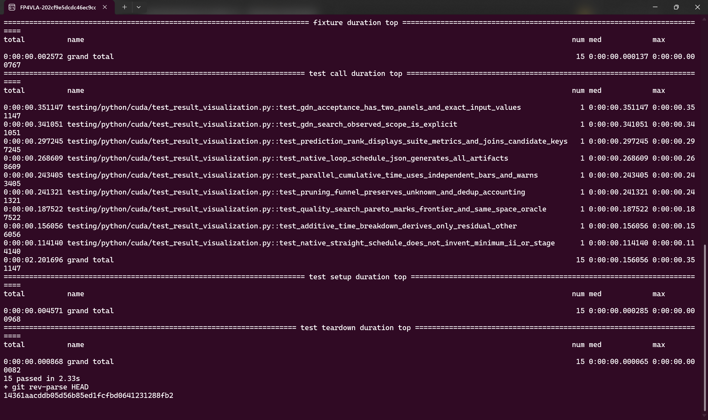
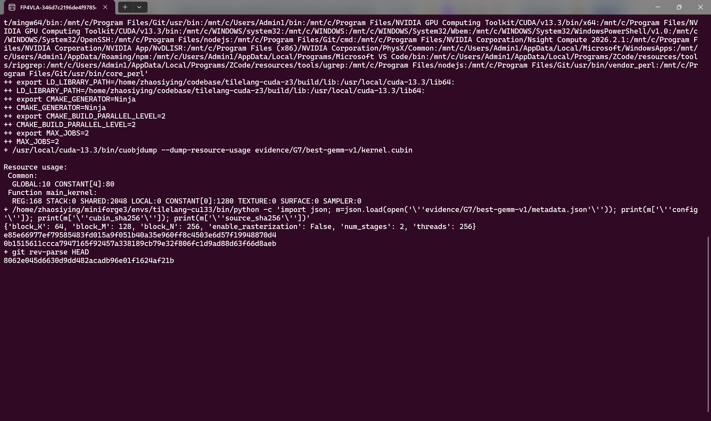

# 真实 Ubuntu 执行截图与终端证据

## 1. 截图口径

本章只把通过窗口绑定、原始日志和内容检查的终端图片称为“已接受截图”。既有方法已由用户确认：Windows Terminal 最大化、紫色 Ubuntu 主题、3840×2400 原始全屏，去除任务栏后为 3840×2280。命令由 `set -x` 或等价方式真实回显，原图、raw log、crop 与窗口绑定 sidecar 一并保存；没有用排版后的文本图片代替终端。

已接受样张的 manifest 明确记录方法复用和逐图复核要求，见 [capture-manifest.json](../../evidence/G7/screenshots/capture-manifest.json)。截图中的 commit 是执行当时 HEAD，不要求与最终文章 commit 相同；最终源码状态以仓库历史和交付 manifest 为准。

## 2. 环境与真实测试样张

下图来自真实 pytest 与 `git rev-parse HEAD`，屏幕中可见 `15 passed`。它不是性能图，也不代替后续完整回归；作用是让环境、终端主题、命令和原始退出状态可以互相核对。

对应 [原始执行日志](../../evidence/G7/screenshots/tilelang-cuda-z3-sample-v3.log)、[全屏原图](../../evidence/G7/screenshots/tilelang-cuda-z3-sample-v3-original.png) 和 [窗口绑定](../../evidence/G7/screenshots/tilelang-cuda-z3-sample-v3.png.window-binding.json)。最终新增回归则分套件记录为 solver/latency/cost 110 passed、pipeline 148 passed、AutoTuner 96 passed + 2 skipped、GDN 57 passed，以及集成与文章/矩阵工具 106 passed + 4 subtests，日志位于 `evidence/G7/final-*.txt`。

## 3. 最佳 GEMM cubin 的资源证据

方形 GEMM guided winner 的真实 `JITKernel` 被导出为 `source.cu` 和 `kernel.cubin`，再用 NVCC/cuobjdump 检查产物。接受图展示配置 `block_K=64, block_M=128, block_N=256, num_stages=2, threads=256`，以及 `main_kernel` 的 REG 168、STACK 0、SHARED 2048、LOCAL 0。`SHARED:2048` 是 cuobjdump 的 static shared 字段，不能解释成该 kernel 的完整动态 shared 总量。

原始 [resource-usage.txt](../../evidence/G7/best-gemm-v1/resource-usage.txt)、[metadata.json](../../evidence/G7/best-gemm-v1/metadata.json)、[kernel.sass](../../evidence/G7/best-gemm-v1/kernel.sass) 和 [终端日志](../../evidence/G7/best-gemm-v1/tilelang-cuda-z3-best-gemm-v3.log) 可交叉检查。metadata 还记录 cubin SHA256 `e85e66977ef79585483fd015a9f051b40a35e960ff8c4503e6d57f19948870d4` 和 source SHA256 `0b1515611ccca7947165f92457a338189cb79e32f806fc1d9ad88d63f66d8aeb`。

## 4. stock 与 guided 的真实搜索日志

补充执行使用 T8192 forward、fresh run-owned cache、warmup=10、repeat=50，依次运行 stock-raw 和 z3-cm-topk。该单次执行只用于终端证据，不替代正式三轮中位数。

| 本次 arm | compile / profile | end-to-end (s) | search best (ms) | 数据来源 |
|---|---:|---:|---:|---|
| stock-raw | 4 / 3 | 34.155725 | 0.302809 | [stock.log](../../evidence/G6/gdn-stock-guided-screenshot-v1/stock.log) |
| z3-cm-topk | 2 / 2 | 19.434959 | 0.302092 | [guided.log](../../evidence/G6/gdn-stock-guided-screenshot-v1/guided.log) |

两次命令均完成后，真实分析器从 events 重算得到单次 speedup **1.757438×**，见 [summary.csv](../../evidence/G6/gdn-stock-guided-screenshot-v1/analysis/summary.csv) 和 [复算分析](../../evidence/G7/screenshots/stock-guided-analysis-v2/analysis.json)。正式结果仍采用 [T8192 三轮 cold 与独立确认](gdn-acceptance.md)，不把本次单轮数字混入正式分母。

补充抓屏没有产生可接受的新 PNG：第一次 foreground 获取失败，第二次仍然失败，随后确认 LockApp 已处于活动状态。没有强制 focus、绕过锁屏或重复 GPU 搜索来修图，因此本节只引用真实执行与分析日志，不拿旧图片冒充本次屏幕。失败 sidecar 和完整日志保存在 [第一次记录](../../evidence/G7/screenshot-failure-v2/capture-failure.json) 与 [第二次记录](../../evidence/G7/screenshot-failure-v3/capture-failure.json)。

## 5. 与性能结论的关系

截图证明的是命令确实在指定 WSL Ubuntu 环境中执行、输出可与文件交叉核对；它不单独证明速度、正确性或功能完整性。性能仍由 cold 搜索和独立 ABBA 决定，correctness 仍由独立 reference 决定，广泛编译覆盖则由 729 行矩阵和逐节点日志决定。已接受的截图、未接受的抓屏、真实失败和最终分析各自保留，避免把“有图片”误当作“该轮实验通过”。
